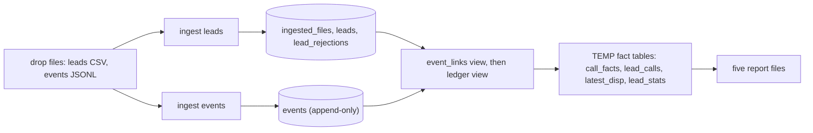

# Submission

> Replace everything in _italics_. Be concise: bullet points are fine. We read every word.

## Candidate
- **Name:** Md Faizan Ali
- **Assignment chosen:** A (Data)
- **Time spent (honest estimate):** about 5h of my own time across two days (planning, reviewing, setup and testing); most of the code was written by AI sessions, see `AI_USAGE.md`

## How to run
From a clean clone (macOS / Linux shown; Windows PowerShell commands are in [`solution/README.md`](solution/README.md)):

```bash
python -m venv .venv
source .venv/bin/activate
pip install -r requirements.txt
python assignment-a-data/tools/generate_data.py --seed 42 --scale small --out data
cd solution
python -m ledger ingest ../data/drop_1
python -m ledger ingest ../data/drop_2
python -m ledger report --out ../reports
python -m pytest -q
```

- `--db PATH` (before the sub-command) picks the SQLite file; default `ledger.sqlite` in the current directory.
- `ingest` accepts several drops and processes them in order. Re-running is safe.
- PII key: `AU_PII_KEY` env var (a Fernet key), otherwise `<db>.key` is created next to the database. Both are gitignored by the existing `*.sqlite*` rule.

## Design



**Schema** (SQLite, `solution/ledger/db.py`):
- `ingested_files`: one row per file, with a unique `sha256` of its content. This is the idempotency key. It also holds the per-file counters (rows, rejected, merged, field warnings, events read, malformed, duplicate) that feed `data_quality.json`.
- `leads`: unique on `(workflow_id, phone_hash)`, which is the lead identity. `phone_hash` is a keyed HMAC of the canonical phone, used for matching. `phone_last4` is kept in clear because the lead report needs it. `attributes` is JSON of the non-PII schema fields (normalised, nulls included); `pii` is JSON of the PII fields (name, phone) as Fernet tokens. `batch_id` is set once, by the first valid row, and never changes. A JSON blob lets one table serve any workflow schema.
- `lead_rejections`: `(workflow_id, batch_id, row_number)` is the primary key, plus the reason. The reason never contains PII.
- `dispositions`: the catalogue from `dispositions.csv`, reloaded on every ingest.
- `events`: the append-only ledger, keyed by `event_id` (this is what drops duplicates). `BEFORE UPDATE` and `BEFORE DELETE` triggers abort any change. `occurred_at` is stored as IST ISO-8601 text, so text order is time order. Only the phone hash is stored, never the raw phone. The `payload` JSON is kept as received, and `disposition_code` is copied out of it for disposition events.

**Query-time linking.** Events are stored exactly as they arrive. Which lead an event belongs to is not stored; the `event_links` view computes it. Non-override events join `leads` on `(workflow_id, phone_hash)`. A `disposition.override` has no phone, so it links through its `call_id` to the lead of that call's phone-linked events. `lead_id NULL` means orphan. The `ledger` view is the usable ledger: linked events only, with unknown disposition codes left out. Because nothing is rewritten when a lead arrives, an event that was an orphan after `drop_1` stops being one once its lead shows up in `drop_2`, orphan counts always describe the final state, and the order in which drops are ingested cannot change the linking. The "split drops equal one-shot" requirement falls out of this design instead of needing special code.

**PII.** Names and phones are Fernet-encrypted (AES-128-CBC with HMAC) in `leads.pii`. Matching uses HMAC-SHA256 of the canonical `+91XXXXXXXXXX` phone, with a key derived from the Fernet key. It is deterministic, so leads and events match on it, but the phone cannot be recovered or brute-forced from it without the key (a plain unkeyed hash of a 10-digit number could be brute-forced quickly). Raw phones from events are hashed at ingest and never stored. Tests check that the database file bytes contain no raw phone or name. The key comes from `AU_PII_KEY` or an auto-created key file; production would use a KMS.

**Idempotency.** Each file is identified by the SHA-256 of its content, and an already-seen hash is skipped. Each drop (leads, then events) is one transaction, so a crash rolls the whole drop back and a re-run redoes it. Re-running `ingest` on an ingested drop changes nothing.

**Reports in SQL.** `report` builds four TEMP tables once per run (`call_facts`, `lead_calls`, `latest_disp`, `lead_stats`) from the `ledger` view, then each report is a plain `SELECT` over them. Python only formats and writes. `report` does not need the PII key.

## Decisions & assumptions

| Decision | Why | Alternative considered |
|---|---|---|
| Decimals round with `ROUND_HALF_UP` to 2 places (12.345 becomes 12.35) | The spec says "round to 2 places" without a mode; half-up is what people expect for currency | Python's default banker's rounding |
| Full language names ("Hindi", "tamil", "english") are invalid enum values: null plus one field warning | The spec compares enum values against `values`, and these are not in it | Mapping names to codes, which silently widens the schema |
| If two columns map to one field, the first column wins | Deterministic, and the spec is silent | Last wins, or merging the two |
| A required non-phone value that is present but invalid is rejected as `missing_required:<field>` | The spec defines only two reasons. This cannot happen with the given schemas (their required non-phone fields are strings) | Adding a new reason such as `invalid_<field>` |
| Defaults are applied at ingest, to fields still null after the row is merged | Equivalent to applying them after all merging, because a later row only ever overwrites with non-null values | A second pass, or defaults at report time |
| A file's identity is its content hash: an identical file re-delivered under another name is skipped, and a changed file with the same name is ingested as new | Idempotency by content is robust to renames and needs no naming convention | Keying on file path or name |
| Malformed also covers non-object JSON, a missing or non-string `event_type`, and a missing or unparseable `occurred_at` | An event with no time or type cannot be placed in the ledger or classified; the spec names only bad JSON and a missing `event_id` | Storing such events with null fields |
| The first copy of a duplicate `event_id` wins | The spec says later copies are skipped; `INSERT OR IGNORE` on the primary key | Keeping the latest copy |
| Event files are read as UTF-8 with undecodable bytes replaced (`errors="replace"`) | A bad byte makes that line malformed instead of aborting the whole drop | Failing the drop |
| An event whose phone is invalid is an orphan | It cannot match any lead, and orphan is the spec's bucket for unlinkable events | A separate counter for invalid-phone events |
| An override links through the phone-linked events of the same call in the same workflow; if they ever pointed at different leads, the lowest `lead_id` wins | Deterministic. In the generated data a call's events agree | Rejecting or flagging the conflict |
| Unknown dispositions are counted only among linked events (orphan check first) | The README lists orphan before unknown disposition | Counting them before linking |
| Effective disposition is the latest override, else the latest set; ties on `occurred_at` are broken by `event_id` DESC | Deterministic and independent of file order | Ingest order |
| `current_disposition`: ties between calls on initiated time are broken by `call_id` DESC | Same reason | Arbitrary choice |
| A call is identified by `(lead, call_id)` and needs a linked `call.initiated` with a `call_id`; events of any other call are ignored, dispositions included | The spec says a call counts only if its `call.initiated` is present and linked | Treating any `call_id` as a call |
| A batch with every row rejected has no `batch_summary` row | A batch is derived from leads and it has none | Emitting a row of zeros |
| `connectivity_rate` is formatted with Python `f"{x:.4f}"` | Exactly 4 decimals, as the contract says | Formatting in SQL |
| `phone_last4` is stored in clear | Reports need the mask, and four digits alone identify nobody | Decrypting the phone at report time, which would need the key |
| Unknown workflow directories under `leads/` are skipped with a warning | There is no schema, so nothing can be validated | Failing the ingest |
| The disposition catalogue is reloaded from `dispositions.csv` on every ingest | The catalogue is data, so changes take effect without a migration | Loading it once |

## Failure modes considered
- **Re-runs:** every file is skipped by content hash; `report` can run any number of times.
- **Crash mid-drop:** one transaction per drop, so a rollback leaves nothing half-applied and the re-run redoes the drop.
- **Out-of-order and early events:** linking is computed at query time. An event that arrives before its lead (a drop earlier) is an orphan until the lead arrives, then it counts.
- **Duplicates:** events within a file, across files and across drops (by `event_id`); duplicate lead rows merge deterministically.
- **Bad input:** malformed JSON lines, undecodable bytes, non-object lines, missing fields, blank lines, renamed and reordered columns, extra columns, unknown workflow directories.
- **Not handled:**
  - **Key mismatch:** if `AU_PII_KEY` changes or the key file is lost, stored names and phones cannot be decrypted, and new leads and events hash differently, so they will not match old rows. There is no key rotation.
  - **Concurrent ingest processes:** SQLite is single-writer and the pipeline is not designed for concurrent runs.
  - **Drop order:** ingesting drops in a different order changes which batch a duplicated lead belongs to (the first valid row wins). That is inherent in the spec.
  - **Corrected re-uploads:** a corrected file with the same name has a new content hash, so it is ingested as a new file and merged again, not treated as a replacement.
  - **Report cost:** reports recompute from the whole ledger on each run.

## Testing
79 tests in `solution/tests/` (`python -m pytest -q`, about 5 s):
- `test_parse.py` (49): header normalisation, phone formats (with 91 and 0 prefixes, invalid numbers), dates (four formats, impossible dates), decimals (prefixes, commas, rounding, invalid), enums, timestamps (UTC, offset, naive IST, midnight rollover).
- `test_leads.py` (9): aliases and extra columns, blank rows and row numbering, rejection order, field warnings, merging across files, defaults, re-ingest changes nothing, separate drops equal combined, no PII in the database bytes.
- `test_events.py` (11): malformed lines, duplicates within a file and across drops, IST storage, override linking through `call_id`, an override without a known call is an orphan, an orphan resolves when its lead arrives later, unknown dispositions, append-only triggers, re-ingest, no raw phone in the database file.
- `test_reports.py` (9): all four buckets, override beats set (latest override wins), the original event stays in the ledger, calls without `call.initiated` are ignored, UTC to IST date rollover, daily overview rate and distinct success leads, lead report fields, `rejections.csv`, `data_quality.json` key order.
- `test_end_to_end.py` (1): generates a fresh dataset (seed 7) and checks that the five report files are byte-identical for `drop_1` then `drop_2`, both drops in one call, and repeated ingest, each with a fresh PII key.
- **Independent reference check:** I also had a plain-Python implementation written from the assignment README only (no SQL, no code shared with the pipeline) and diffed all five files on seeds 42 and 7; they matched exactly. It was a throwaway script and is **not committed**.
- **Not tested:** the large dataset was only timed by hand, there are no property-based tests, and PostgreSQL was not tried.

## Results
**Seed 42, `--scale small`** (rerun on `main` before submitting):
- 2057 lead rows, 108 rejected (`invalid_phone` 42, `missing_required:customer_name` 25, `missing_required:order_id` 13, `missing_required:phone` 14, `missing_required:policy_number` 14), 57 duplicate rows merged, 122 field warnings.
- 1892 leads (951 `motor_renewal`, 941 `policy_feedback`): 512 `yet_to_reach_out`, 38 `in_progress_telephony_failed`, 526 `in_progress_dialed`, 816 `completed`.
- 8745 event lines: 8 malformed, 237 duplicates dropped, 462 orphans (1123 after `drop_1` alone, so 661 events resolved once `drop_2`'s leads arrived), 18 unknown dispositions.

**Large scale** (seed 42, 132,903 leads, 632,602 event lines of which 613,481 are stored; Windows laptop, Python 3.12, SQLite):
- First measurement: ingest of both drops 68.3 s, report 50.1 s (about 118 s in total).
- Rerun on the same laptop later the same day: ingest 98.7 s, report 53.2 s (about 152 s in total). Ingest time varied by about 30 s between runs, so I would not promise a number under 2 minutes.
- Rerun counts: 143,990 lead rows, 7,097 rejected, 3,990 merged, 34,424 orphan events, 1,005 unknown dispositions.
- The first version of the report SQL did not finish in 30+ minutes. SQLite planned the join to a CTE as a scan per lead. The fix was to materialize `call_facts`, `lead_calls`, `latest_disp` and `lead_stats` as TEMP tables keyed by `lead_id`, so the final joins are primary-key lookups. The output was byte-identical before and after.

**Surprises in the data:**
- Full language names ("Hindi", "tamil", "english") instead of codes.
- Landline-style and `N/A` phones.
- Free-text amounts ("twelve thousand") and dates ("soon", "TBD"), and impossible dates (31/02, month 13).
- `batch_003` renames and reorders columns and adds an "agent notes" column.
- 4 invalid JSON lines per drop.
- Duplicate events across drops.
- Events arriving a drop before their lead.

## Stretch goals
- **Aggregation in SQL:** done. Reports are `SELECT`s over TEMP fact tables built from the `ledger` view.
- **Performance:** done, with a caveat. Timings are above. Ingest plus report took about 118 s on the first measurement and about 152 s on a later rerun, so the "under 2 minutes" target is borderline and not reliably met.
- **Incremental at the file level:** done. Already-ingested files are skipped by content hash, so drop 2 does not re-process drop 1's files, but reports recompute from the whole ledger each run. Trade-off: simple and always consistent (no stored aggregate can go stale when an old orphan resolves), at the cost of recomputing everything each run.
- **Production note, 100k leads/day:**
  - Postgres instead of SQLite (concurrent writers, a real server, partitioning).
  - Drops land in object storage and a scheduler runs ingest for each new file. Per-file idempotency is already in place, so retries are safe.
  - Partition `events` by date, and enforce append-only with revoked UPDATE and DELETE privileges instead of triggers.
  - Incremental aggregates (daily and per-lead tables refreshed for affected leads only) instead of a full recompute.
  - Backfills by replaying files; the content-hash key makes a replay a no-op for files already loaded.
  - Alerting on orphan, malformed and rejection rates per drop.
  - The key in a KMS or secret manager, with rotation (re-encrypt and re-hash).

## If I had another day
1. PII key rotation, and a clear failure when the key does not match the database (today it surfaces as a decrypt error or as silent non-matches).
2. A lock (or a clear error) so two concurrent `ingest` runs cannot interleave.
3. Treat a corrected re-upload of the same file name as a replacement instead of a new file merged again.
4. Incremental report maintenance, so a run does not recompute the whole ledger.
5. Property-based tests on the parsers and on drop-order equivalence, plus a repeatable large-scale benchmark script.
6. Try the schema on PostgreSQL.
